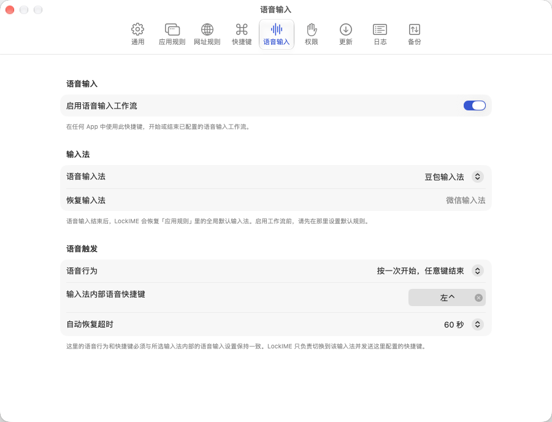

<div align="center">


# LockIME Voice

**English** · [简体中文](docs/README/README.zh-CN.md) · [繁體中文](docs/README/README.zh-TW.md) · [日本語](docs/README/README.ja.md) · [Français](docs/README/README.fr.md) · [Deutsch](docs/README/README.de.md) · [Español](docs/README/README.es.md) · [Português](docs/README/README.pt.md) · [Русский](docs/README/README.ru.md)

[](https://github.com/panda-z519/LockIME-Voice/actions/workflows/ci.yml)
[](LICENSE)
[](https://www.apple.com/macos/)
[](https://swift.org)

</div>

> **LockIME Voice source fork.** This GPL-3.0 derivative adds the configurable
> voice-input workflow. `v0.1.6` provides ad-hoc-signed preview installers, but
> Developer ID signing, notarization, Sparkle updates, and Homebrew distribution
> are not available.

A macOS menu-bar app that **locks your keyboard input source**. Whenever you (or
another app) switch input methods, LockIME immediately switches back to the locked
one — globally, or per-frontmost-app, or (with the optional enhanced mode) per
browser URL.

> macOS 14+ · Apple silicon & Intel — separate apps, download the `-arm64` or
> `-x86_64` file matching your Mac · built with SwiftUI, Liquid Glass on
> macOS 26 (Tahoe).

## Screenshots

<p align="center">
  <picture>
    <source media="(prefers-color-scheme: dark)" srcset="docs/images/settings-general-en-dark.png">
    
  </picture>
  <picture>
    <source media="(prefers-color-scheme: dark)" srcset="docs/images/settings-app-rules-en-dark.png">
    
  </picture>
  <picture>
    <source media="(prefers-color-scheme: dark)" srcset="docs/images/settings-url-rules-en-dark.png">
    
  </picture>
</p>

## Changes in LockIME Voice

Compared with upstream LockIME, this fork adds and changes the following:

- **Configurable voice input source** — no input method is hard-coded; Doubao,
  WeChat, or another installed input source can be selected.
- **One shortcut, taken over** — record the same voice shortcut your input
  method uses. LockIME consumes that key so the input method never sees the
  press (which is what stops macOS reporting a shortcut conflict), then sends it
  back to start and stop recording. Left/right modifiers and multi-key
  combinations are supported.
- **Three voice behaviors** — press again to end, hold to speak, or press any
  key to end, matching the selected input method's own setting.
- **Rule-safe temporary override** — normal LockIME enforcement pauses while
  voice input owns the source, preventing an immediate switch back to default.
- **Default-source restore** — the restore target comes from the global default
  in **App Rules**; there is no duplicate "daily input source" setting.
- **Reliable repeated use** — source confirmation, stale-task cancellation,
  safety timeout, synthetic-event filtering, and session shortcut snapshots
  prevent missed or self-cancelled activations.
- **Clearer menu ordering** — the global default source appears first and uses
  a pin marker rather than a checkmark.



## Install

Download the installer matching your Mac:

- [Apple silicon (arm64)](https://github.com/panda-z519/LockIME-Voice/releases/download/v0.1.6/LockIME-Voice-0.1.6-arm64.dmg)
- [Intel (x86_64)](https://github.com/panda-z519/LockIME-Voice/releases/download/v0.1.6/LockIME-Voice-0.1.6-x86_64.dmg)

Verify your download before opening it. Each Release publishes a
`SHA256SUMS.txt`, so the checksum always matches the artifact built for that tag
(the DMG is not byte-reproducible, so no checksum belongs in this file):

```sh
gh release download v0.1.6 --repo panda-z519/LockIME-Voice \
  --pattern 'LockIME-Voice-0.1.6-*.dmg' --pattern SHA256SUMS.txt
shasum -a 256 -c SHA256SUMS.txt
```

That verification is what makes **Open Anyway** safe for an unnotarized build —
never bypass Gatekeeper for a download you have not checked.

Open the DMG and drag **LockIME Voice** to Applications. This preview is
ad-hoc signed and **not notarized**, so the first launch is blocked by
Gatekeeper:

1. Double-click **LockIME Voice**. macOS refuses it with *"Apple could not
   verify that LockIME Voice is free of malware"* — that is expected, not a
   sign of a broken download.
2. Open **System Settings ▸ Privacy & Security** and scroll to the
   **Security** section. **LockIME Voice** is listed there with an
   **Open Anyway** button.
3. Click **Open Anyway**, authenticate, then confirm with **Open** in the
   follow-up dialog. The app now starts normally on every later launch.

Only trust a copy you downloaded from this repository's release page and whose
SHA-256 matches the checksum above — that is what makes "Open Anyway" safe for
an unnotarized build. After launching, grant **Accessibility** when asked (the
voice workflow needs it; the same dialog also covers sending keyboard events).

To build from source instead:

```sh
brew install xcodegen xcbeautify
make build
open "build/DerivedData/Build/Products/Debug/LockIME Voice Dev.app"
```

Reinstalling or rebuilding an ad-hoc-signed app can require granting its macOS
permissions again. Automatic updates are not available.

## Features

- **Instant re-lock** — switches the active input source back the moment you (or
  another app) change it, globally or per-app.
- **Conflict-aware** — if another program keeps re-asserting its own input
  source (say, a game with built-in IME management), LockIME notices the
  tug-of-war and briefly stands down instead of flip-flopping forever,
  recording *Conflict detected* in the activation log; give such an app its
  own *Ignore* or *Switch to* rule for a lasting fix.
- **Bare-process rules** — programs that run from a bare executable rather than
  an `.app` bundle (say, Minecraft's `java`, spawned by a third-party launcher)
  can get rules too: while they are running, the app picker lists them under a
  synthetic `process:<executable>` identity (e.g. `process:java`).
- **Lock or switch** — per-app and per-URL rules can *lock* an input source
  (re-applied whenever it drifts) or just *switch* to it once when you focus the
  app or page, then step out of the way and let you change it freely.
- **Lock globally, or just switch** — give the global default input source one of
  three behaviors: *lock* to pin it everywhere; *switch* to switch you into it
  once whenever an app falls back to the global default (it has no rule of its
  own, or its rule is *Use default*), then leave you free; or **None** for no
  global behavior at all — LockIME then acts only through your per-app and per-URL
  rules. *Switch* actively switches you in whenever the default applies; **None**
  does nothing globally.
- **Flexible URL matching** — per-URL rules (enhanced mode) match by a domain and
  its subdomains, an exact domain, a domain keyword, or a regular expression over
  the full URL, and apply in a priority order you drag to arrange — first match
  wins.
- **Menu-bar control** — activate/deactivate, switch the locked input source,
  view the current source, and track the activation count from the menu bar.
- **Keyboard shortcuts** — configurable global shortcuts to toggle LockIME on or
  off and cycle the locked input source, plus per-app shortcuts to cycle or
  unbind the rule for whichever app is frontmost.
- **Voice input workflow** — press LockIME's own voice shortcut and it sends the
  voice shortcut configured inside your input method. Enable automatic switching
  to have it move to a configured voice input source for the session and restore
  your daily source afterwards. Keep the two shortcuts different.
- **Launch at login** — starts automatically when you log in (off by default).
- **Light & dark mode** — a unified, system-native design language that adapts to
  light and dark appearance, plus a bespoke app icon. See
  [docs/DESIGN.md](docs/DESIGN.md).
- **Live language switching** — switch between 9 languages instantly, no
  restart: English, 简体中文, 繁體中文, 日本語, Français, Deutsch, Español,
  Português, Русский.
- **24-hour activation log** — review what was switched, why, and for how long.
- **Config backup** — export your per-app and per-URL rules to a `.lockime`
  file and import them back, with a review step that previews additions,
  conflicts, and removals before anything is applied.
- **Tiny download** — the whole app ships in a `.dmg` under 3 MB.
- **No system permissions for core locking** — an optional Accessibility-gated
  enhanced mode unlocks finer-grained per-URL and focused-field rules.
- **Automation** — a `lockime-voice://` URL scheme lets other apps, scripts, and
  Shortcuts drive LockIME (see below).

## Voice Input Workflow

The voice input source is fully configurable; LockIME Voice does not hard-code
Doubao, WeChat, or any other input method.

1. Open **Settings ▸ Voice Input** and enable the workflow.
2. Record **Voice shortcut** — the same shortcut you use for voice input inside
   your input method. LockIME takes that key over.
3. Optionally choose a voice input source and turn on automatic switching.
4. Grant **Accessibility**. It is required for LockIME to take the voice shortcut
   over; without it the key falls through to the input method and macOS reports a
   shortcut conflict again. The core lock still needs no permissions.

### Why there is no conflict

LockIME consumes the voice key, so your input method never sees the physical
press — it has nothing to conflict with. LockIME then sends that same key back to
start and stop recording, marked so its own listener ignores the echo.

This is the difference from the earlier two-shortcut design, which asked you to
keep two different combinations and still left the input method reacting to its
own key.

Test the workflow in TextEdit or another plain text field. Seeing the voice panel
is not enough: recognized text must appear at the current cursor position.
## Comparison

The two most widely-used alternatives to LockIME are
**[Input Source Pro](https://github.com/runjuu/InputSourcePro)** and
**[KeyboardHolder](https://github.com/leaves615/KeyboardHolder)**, alongside a
long tail of smaller open-source and CLI tools. They all *switch* the input
source as you move between apps or sites; LockIME is built around a continuous
**lock** that re-applies it the moment it drifts — while any rule can still fall
back to a one-time *switch*.

| | LockIME | Input Source Pro | KeyboardHolder |
|---|---|---|---|
| Price | Free | Free | Free (donation) |
| Open source | GPL-3.0 | GPL-3.0 | ✗ (closed) |
| Minimum macOS | 14 | 11 | 10.15 |
| Download size | < 3 MB | ≈ 7.6 MB | ≈ 4.5 MB |
| Per-app rules | ✓ | ✓ | ✓ |
| Per-website / URL rules | ✓ | ✓ | ✓ |
| URL match types | subdomain · exact · keyword · regex | subdomain · exact · regex | domain (wildcard) |
| Address-bar (URL field) rule | ✓ (lock/switch/priority) | ✓ (default source) | — |
| Continuous re-lock | ✓ | ✗ | ✗ |
| Lock *or* one-time switch, per rule | ✓ | ✗ | ✗ |
| Global keyboard shortcuts | ✓ | ✓ | ✗ |
| Menu-bar control | ✓ | ✓ | ✓ |
| On-screen input hints | ✗ | ✓ | ✓ (optional) |
| 24-hour activation log | ✓ | ✗ | ✗ |
| Config backup / import | ✓ (`.lockime`, with review) | ✓ (export/import + CLI) | — |
| URL-scheme automation | ✓ (`lockime-voice://`, x-callback-url) | partial (`inputsourcepro://` import) | ✗ |
| UI languages | 9 (live switch) | 6 | zh · en · ja |
| System permissions | none for core · Accessibility for per-URL | none for core · Accessibility for per-URL | Accessibility¹ |
| Auto-update | ✗ (source-only fork) | ✓ | ✓ |
| Actively maintained (2026) | ✓ | ✓ | ✓ |

¹ KeyboardHolder does not document its permission requirements; reading the
browser address bar for its per-website rules requires Accessibility access in
practice. A "—" marks an undocumented capability, not a confirmed absence.

**Choosing between them:** Input Source Pro has the largest community and the
richest on-screen input hints; KeyboardHolder is a polished, zero-config per-app
memory. Reach for LockIME when you want an input source *pinned* — per app, per
URL, or in the address bar, re-applied the instant anything changes it — rather
than only switched when you arrive.

**Other tools:** [SwitchKey](https://github.com/itsuhane/SwitchKey) (per-app
only, no longer maintained), [Kawa](https://github.com/hatashiro/kawa) (manual,
shortcut-driven), InputSwitcher (freemium, per-app only), and
[macism](https://github.com/laishulu/macism) (a command-line building block, not
a GUI switcher).

> Compared against Input Source Pro 2.11.0 and KeyboardHolder 1.14.10, mid-2026 — details drift; corrections welcome.

## Automation

LockIME exposes a `lockime-voice://` URL scheme so other apps, scripts, Shortcuts, and
launchers can drive it — turn it on or off, retarget the input source, manage
rules, and read state back with [x-callback-url](https://x-callback-url.com)
callbacks. It is off by default — turn it on in **Settings ▸ General ▸
Automation**.

```sh
open "lockime-voice://lock"
open "lockime-voice://lock-to-source?id=com.apple.keylayout.ABC"
open "lockime-voice://set-app-rule?bundle=com.apple.Terminal&mode=lock&source=com.apple.keylayout.ABC"
```

Full reference: **[URL Scheme API](docs/URL-Scheme-API/README.md)**.

## Design

LockIME follows a single design system (`Sources/LockIME/UI/DesignSystem.swift`):
semantic colors, system materials, and SF Symbols drive light/dark adaptation;
Liquid Glass is reserved for the floating/navigation layer only. The brand
"Lock Indigo" accent ships as an `AccentColor` asset. The full spec lives in
[docs/DESIGN.md](docs/DESIGN.md).

The app icon is generated programmatically (no design tool) — regenerate it with:

```sh
./scripts/make-appicon.sh   # renders the master via SwiftUI and rebuilds the appiconset
```

## Development

Requires Xcode 26+ (the app itself targets macOS 14+), and
[XcodeGen](https://github.com/yonaskolb/XcodeGen)
+ [xcbeautify](https://github.com/cpisciotta/xcbeautify) (`brew install xcodegen xcbeautify`).

```sh
make gen     # generate LockIMEVoice.xcodeproj from project.yml
make build   # build (Debug)
make run     # build & launch
make test    # run unit tests
make archive # ad-hoc-signed Release archive
```

The Xcode project is generated from `project.yml` and is not checked in.

Hardware-touching integration tests (real TIS switching) are excluded from
`make test`; run them with `make test-hw` (briefly changes the input source).

## Releasing

Preview DMGs are built and uploaded manually. Developer ID, notarization,
Sparkle, nightly, and Homebrew workflows remain disabled. See
[docs/RELEASING.md](docs/RELEASING.md) for packaging and verification details.

## Architecture

- **LockIMEKit** (static library) — pure, fully unit-tested logic using only system
  frameworks: lock engine, app monitor, rules, enhanced (Accessibility) observer,
  logging model, localization.
- **LockIME Voice** (app) — `@main`, SwiftUI UI, the design system, and the thin
  integration shims for Sparkle, KeyboardShortcuts, and PermissionFlow.

## License

Copyright © 2026 Hangzhou Wumou Software Co., Ltd.

Modifications © 2026 zhangsiqiang519.
